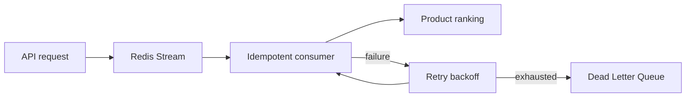
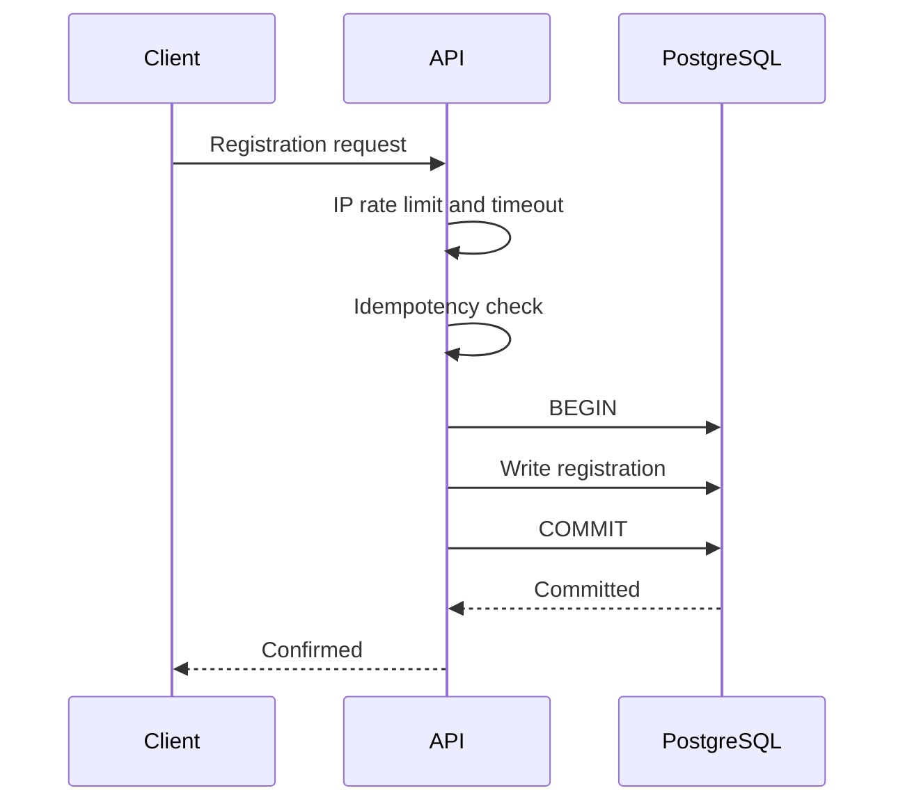
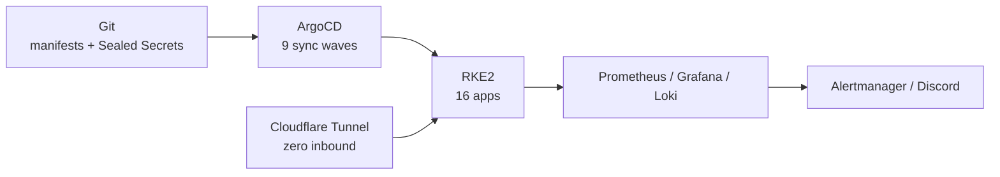

# Muhammad Argya Vityasy

**Backend + Platform Engineer** — Go services, event-driven pipelines, and the infrastructure they run on.

Jakarta-based Computer Science student at Universitas Gadjah Mada, focused on backend engineering, cloud infrastructure, and DevSecOps.

[GitHub](https://github.com/vityasyyy) · [LinkedIn](https://www.linkedin.com/in/vityasy)

     

## How I build

- **Idempotency before throughput.** Duplicate requests and redelivered events are normal, so retried writes are safe to repeat and consumers recover cleanly instead of double-processing.
- **Transactions where state has to agree.** Multi-tenant provisioning and concurrent registration run as atomic transactions, so a failed step rolls back instead of leaving partial state.
- **Heavy work off the request path.** Product ranking runs on streams with retry backoff and dead letter queues, so a slow consumer costs freshness, not availability.
- **Observability before scale.** Dashboards and alerts on the failures that matter — background workers, deployment health — because a system you cannot see is a system you cannot operate.
- **Tests and least exposure at the boundary.** E2E suites exercise agent tool execution in CI, and services stay private behind tunnels and default-deny network policies.

## Experience

### Xendit — Full Stack Developer Intern · Present
Payments infrastructure company.

### GDP Labs — Software Engineer Intern · Feb 2026 – Jun 2026
Enterprise AI automation platform — multi-agent LLM systems for HR, payroll, and project management.

- Built a multi-tenant IAM SDK standardizing authentication across enterprise projects, with tenant isolation and provider sync on atomic multi-provider transactions that prevent partial-state failures on rollback.
- Built LLM-powered agents with structured outputs and tool execution, routing multi-step workflows across 3+ workflow types with provider fallback.
- Built compliance pipelines that scan multi-source HR and payroll data against 8 rule-based checks and generate audit reports.
- Authored Playwright E2E suites in CI validating multi-agent tool execution before production.

### PT Satria Duta Raya — Backend Engineer · Oct 2025 – Jan 2026
B2B procurement platform.

- Architected a Go/Gin backend with 6 domain boundaries.
- Built an event-driven product ranking pipeline on Redis Streams: idempotent consumers, dead letter queues, and retry backoff keep heavy compute off the request path.
- Added Prometheus + Grafana dashboards and alerting on background worker failures.

### JOINMUN 2025 — Backend Engineer · Apr 2025 – Oct 2025
Backend for an international Model United Nations event.

- Held a stable service through 500+ concurrent registration spikes using connection pooling and query tuning; Go + PostgreSQL on Docker.
- Built a role-based admin dashboard with an approval pipeline, cutting manual staff workload by 40% across 150+ staff actions.
- Made writes consistent under concurrency with PostgreSQL transactions, idempotent retries, timeouts, and IP-based rate limiting middleware; added structured logging.

### OmahTI UGM — Backend Engineer · Mar 2024 – Jul 2025
Student IT organization at Universitas Gadjah Mada.

- Built a reusable Go/Node.js/Docker backend framework used across 4 client projects, cutting development and deployment time by 60%.
- Led weekly technical discussions for 15 engineers and drove Docker-based deployment standardization.

## Selected work

### [invenio-rdm-gitops](https://github.com/vityasyyy/invenio-rdm-gitops) — GitOps platform on RKE2

InvenioRDM deployment for a university on a managed RKE2 cluster.

- **What:** 16 applications delivered in 9 ArgoCD sync waves, with a zero-inbound topology.
- **How:** Cloudflare Tunnel for ingress, default-deny NetworkPolicies, Sealed Secrets, and restricted Pod Security Admission; a 3-pipeline CI for manifest validation, secret scanning, and deployment health; Prometheus, Grafana, Loki, and Alertmanager behind 4 dashboards with Discord alerting.
- **Outcome:** deployments are Git-driven and health-checked, the cluster has no public inbound surface, and the stack includes backup/recovery tooling.

### [do-self-host](https://github.com/vityasyyy/do-self-host) — self-hosting lab

- **What:** a personal lab on DigitalOcean for running and operating services.
- **How:** Terraform provisions, Ansible configures, Prometheus, Grafana, Loki, and Node Exporter observe, and Cloudflare Zero Trust gates access.
- **Outcome:** provisioning, configuration, and monitoring live in code.

### [skripsi](https://github.com/vityasyyy/skripsi) — undergraduate thesis

Controlled comparison of manual vs GitOps deployment under configuration drift on Kubernetes clusters.

### More repos

- [omah-to](https://github.com/vityasyyy/omah-to) — SNBT tryout platform for DCSE UGM: timed multi-section tests, microservices with gRPC, Redis-based session and state (architecture-focused; implementation partial).
- [sharedlib](https://github.com/vityasyyy/sharedlib) — Go shared library for JWT verification and logging.
- [Xtream](https://github.com/vityasyyy/Xtream) — Go, scalable video streaming.

## Stack

| Category | Tools |
|---|---|
| Languages | Go, Python, TypeScript |
| Backend | Gin, Express, Pydantic |
| Data | PostgreSQL, MongoDB, Redis (Streams), Kafka, MinIO/S3 |
| Platform | Docker, Kubernetes, ArgoCD, Terraform, Ansible |
| Observability & delivery | Prometheus, Grafana, Loki, OpenTelemetry, Playwright, CI/CD |

## Currently exploring

- OpenTelemetry tracing
- Kubernetes in constrained environments
- GitOps configuration drift (thesis)
